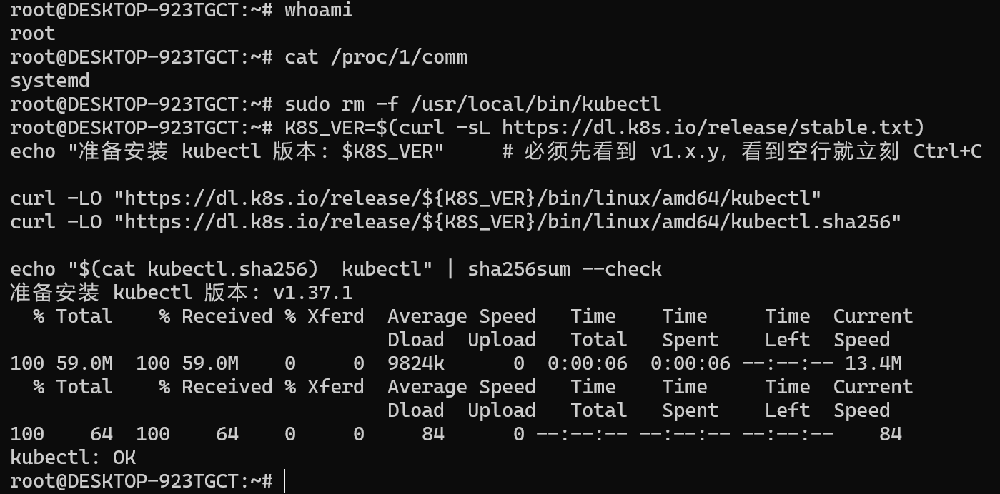
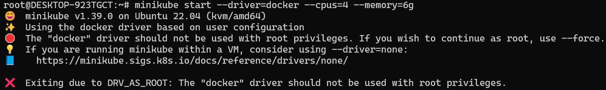
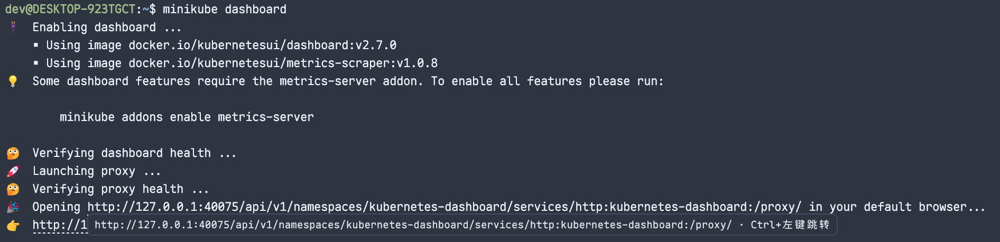
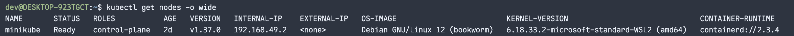

# 前言

Pod是什么？

> Pod 是可以在 Kubernetes 中创建和管理的、最小的可部署的计算单元。


① 打开正确的终端

不要用 PowerShell，用 Windows Terminal → 下拉箭头 → Ubuntu-22.04（或者 Win+R 输 `wsl -d Ubuntu-22.04`）。

进去先自检两个身份：

```bash
whoami            # 期望: rootcat /proc/1/comm  # 期望: systemd   ← 这个证明 systemd 已生效
```

之后所有命令都在这个窗口里敲。

------

② 清掉那个坏文件

```bash
sudo rm -f /usr/local/bin/kubectl
```

------

③ 装 kubectl（这次带哈希校验）

```bash
K8S_VER=$(curl -sL https://dl.k8s.io/release/stable.txt)echo "准备安装 kubectl 版本: $K8S_VER"     # 必须先看到 v1.x.y，看到空行就立刻 Ctrl+C
curl -LO "https://dl.k8s.io/release/${K8S_VER}/bin/linux/amd64/kubectl"curl -LO "https://dl.k8s.io/release/${K8S_VER}/bin/linux/amd64/kubectl.sha256"
echo "$(cat kubectl.sha256)  kubectl" | sha256sum --check
```

看到 `kubectl: OK`。




```bash
sudo install -o root -g root -m 0755 kubectl /usr/local/bin/kubectl
rm -f kubectl kubectl.sha256
kubectl version --client
```


## 安装minikube

```bash
curl -Lo /tmp/minikube https://storage.googleapis.com/minikube/releases/latest/minikube-linux-amd64
sudo install -o root -g root -m 0755 /tmp/minikube /usr/local/bin/minikube
rm -f /tmp/minikube
minikube version

```


## 创建集群

```bash
minikube start --driver=docker --cpus=4 --memory=6g
```

- `--driver=docker`：minikube 用 Docker 起一个容器充当集群节点（因为环境是单机，这个容器既是控制面又是工作节点）
- `--cpus=4 --memory=6g`：给节点 4 核 6G。你 WSL 里是 16 核 15G，留够余量给 Docker 自己

| 现象                                                         | 含义                          |
| ------------------------------------------------------------ | ----------------------------- |
| 最后打印 `Done! kubectl is now configured to use "minikube" cluster` | 成功                          |
| **报 `DRV_AS_ROOT: The "docker" driver should not be used with root privileges`** | **minikube 不接受 root 用户** |
| 卡住不动 / 各种超时                                          | 网络问题                      |



### 解决

创建普通用户，并加入 docker 组

```bash
rm -rf /root/.minikube                        # 删掉 root 身份下创建的空集群目录，避免后面混淆
useradd --create-home --shell /bin/bash --groups sudo,docker dev   # 创建用户 dev：建家目录 /home/dev、shell 用 bash、同时加入 sudo 和 docker 两个附加组
passwd dev                                    # 给 dev 设置登录密码（su 切换要用它，之后 sudo 提权也要用）
id dev                                        # 验证：确认 dev 的 groups 里同时出现 sudo 和 docker
----------output-----------
uid=1000(dev) gid=1000(dev) groups=1000(dev),27(sudo),999(docker)
                                                     ↑ 这两个必须都在
```

切换到 dev 用户，再起集群

```bash
su - dev                                      # 切换到 dev 用户；- 表示 login shell，会重置环境变量和 PATH
whoami                                        # 确认身份已经变成 dev
docker ps                                     # 免 sudo 访问 Docker；能列出容器就说明 docker 组成员身份已生效
command -v kubectl && command -v minikube      # 确认两个工具在 dev 的 PATH 里找得到（/usr/local/bin 对全体用户可见）
minikube start --driver=docker --cpus=4 --memory=6g   # 以 dev 身份创建单节点集群：docker 驱动起节点容器，分它 4 核 6G
-----------output------------
Done! kubectl is now configured to use "minikube" cluster
```

验收

```bash
kubectl config current-context        # 确认当前上下文是 minikube
kubectl get nodes -o wide             # 列节点；-o wide 额外显示内网 IP、OS、内核、容器运行时（看 CONTAINER-RUNTIME 那列）
kubectl get pods -A                   # 列全部命名空间的 Pod；-A 即 --all-namespaces
kubectl cluster-info                  # 打印控制面组件地址（apiserver、CoreDNS）
ls -l ~/.kube/config                  # 确认 kubeconfig 落在 dev 家目录、属主是 dev（这就是我们绕开 --force 的目的）
---------output---------
dev@DESKTOP-923TGCT:~$ kubectl config current-context
minikube
dev@DESKTOP-923TGCT:~$ kubectl get nodes -o wide             # 列节点；-o wide 会多出 IP、OS、内核、CONTAINER-RUNTIME 四列
NAME       STATUS   ROLES           AGE   VERSION   INTERNAL-IP    EXTERNAL-IP   OS-IMAGE                         KERNEL-VERSION                              CONTAINER-RUNTIME
minikube   Ready    control-plane   48s   v1.37.0   192.168.49.2   <none>        Debian GNU/Linux 12 (bookworm)   6.18.33.2-microsoft-standard-WSL2 (amd64)   containerd://2.3.4
dev@DESKTOP-923TGCT:~$ kubectl get pods -A                   # 列全部命名空间的 Pod；-A 即 --all-namespaces
NAMESPACE     NAME                               READY   STATUS    RESTARTS   AGE
kube-system   coredns-559f6c778d-5qjkk           1/1     Running   0          45s
kube-system   coredns-559f6c778d-bb485           1/1     Running   0          45s
kube-system   etcd-minikube                      1/1     Running   0          51s
kube-system   kindnet-vpnsn                      1/1     Running   0          46s
kube-system   kube-apiserver-minikube            1/1     Running   0          55s
kube-system   kube-controller-manager-minikube   1/1     Running   0          51s
kube-system   kube-proxy-zn29l                   1/1     Running   0          46s
kube-system   kube-scheduler-minikube            1/1     Running   0          51s
kube-system   storage-provisioner                1/1     Running   0          50s
dev@DESKTOP-923TGCT:~$ kubectl get pods -n kube-system       # 只看集群系统组件（-n 指定命名空间），这里能看到控制面全家桶
NAME                               READY   STATUS    RESTARTS   AGE
coredns-559f6c778d-5qjkk           1/1     Running   0          55s
coredns-559f6c778d-bb485           1/1     Running   0          55s
etcd-minikube                      1/1     Running   0          61s
kindnet-vpnsn                      1/1     Running   0          56s
kube-apiserver-minikube            1/1     Running   0          65s
kube-controller-manager-minikube   1/1     Running   0          61s
kube-proxy-zn29l                   1/1     Running   0          56s
kube-scheduler-minikube            1/1     Running   0          61s
storage-provisioner                1/1     Running   0          60s
dev@DESKTOP-923TGCT:~$ ls -l ~/.kube/config                  # 确认 kubeconfig 在家目录、属主是 dev —— 这就是当初拒绝 --force 换来的结果
-rw------- 1 dev dev 802 Oct  3 15:02 /home/dev/.kube/config

```


## 可视化面板

minikube dashboard




```bash
kubectl get nodes -o wide   # 列出节点；-o wide 额外显示 IP、OS、内核、容器运行时
kubectl describe node minikube   # 查看节点状态：Addresses / Conditions / Capacity / Info
kubectl get pods -A   # 列出全部命名空间的 Pod；-A 即 --all-namespaces
kubectl get --raw='/healthz'   # 直接请求 API 服务器的健康端点，绕过资源模型
echo   # 换行，避免下一条输出和上面的 ok 黏在一起
kubectl version   # 同时打印客户端与服务端版本
kubectl api-resources | head -12   # 列出集群支持的资源类型，只看前 12 行
kubectl get pods -n kube-system -o custom-columns='名称:.metadata.name,控制器:.metadata.ownerReferences[0].kind,节点:.spec.nodeName'   # 用自定义列展示归属，区分镜像 Pod

```




## minikube


### 创建 Deployment 


### 创建 Service


