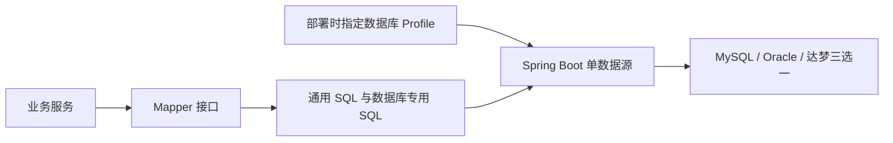

以SpringBoot项目为例，在原来在MySQL数据库的基础上，需要加入其他数据库的支持，比如Oracle、达梦等。支持在不同数据库的场景下运行这个系统。

## 部署模型

同一份 Spring Boot 应用打包一个 JAR。每个部署实例在启动时通过 Spring Profile 选择 MySQL、Oracle 或达梦，使用一个 `DataSource` 和一套事务配置。业务层沿用同一套 Mapper 或 Repository 接口，由持久层处理 SQL 方言差异。已有 MySQL 部署可沿用原连接参数和启动方式，将 `mysql` 设为默认数据库 Profile。



## 1. 用 Spring Profile 切换连接

以 Spring Boot 3 为例，将三种 JDBC 驱动加入运行时依赖。MySQL 使用 `com.mysql:mysql-connector-j`，Oracle 示例使用 `com.oracle.database.jdbc:ojdbc11`，达梦示例使用 `com.dameng:DmJdbcDriver18`。按项目的 JDK、数据库版本及厂商兼容矩阵锁定驱动版本，受 Spring Boot BOM 管理的依赖可沿用 BOM 版本。

| Profile 文件               | `spring.datasource.driver-class-name` | `DB_URL` 示例                                  |
| ------------------------ | ------------------------------------- | -------------------------------------------- |
| `application-mysql.yml`  | `com.mysql.cj.jdbc.Driver`            | `jdbc:mysql://localhost:3306/appdb`          |
| `application-oracle.yml` | `oracle.jdbc.OracleDriver`            | `jdbc:oracle:thin:@//localhost:1521/APP_PDB` |
| `application-dm.yml`     | `dm.jdbc.driver.DmDriver`             | `jdbc:dm://localhost:5236`                   |

在 `application.yml` 中保留公共配置并设定默认 Profile。如果现有部署还使用 `prod` 等环境 Profile，需要在部署配置中同时声明数据库 Profile，例如 `prod,oracle`。每个实例只启用一个数据库 Profile。

```yaml
spring:
  profiles:
    default: mysql
```

各数据库 Profile 可复用下列结构。以 `application-oracle.yml` 为例，其余文件替换驱动类，实际连接地址和凭证由部署环境提供。原有 MySQL 部署继续读取它已使用的配置项，避免升级时额外要求新的环境变量。

```yaml
spring:
  datasource:
    driver-class-name: oracle.jdbc.OracleDriver
    url: ${DB_URL}
    username: ${DB_USER}
    password: ${DB_PASSWORD}
```

公共配置里的 MySQL 专用 JDBC 参数、连接池初始化 SQL、ORM 方言及分页插件配置，需要逐项检查并归入对应数据库配置。切换时配置好 `DB_URL`、`DB_USER` 和 `DB_PASSWORD`，再启动实例，例如 `java -jar app.jar --spring.profiles.active=oracle`。

## 2. 在持久层适配 SQL

### MyBatis 按 `databaseId` 选择语句

使用 MyBatis Spring Boot Starter 的自动配置时，可注册 `DatabaseIdProvider`。如果项目手动创建 `SqlSessionFactoryBean`，需要在工厂上调用 `setDatabaseIdProvider`。映射依据 JDBC `DatabaseMetaData#getDatabaseProductName()` 的返回值，尤其要用目标版本的达梦驱动实测产品名。

```java
@Configuration
public class MyBatisDialectConfiguration {
    @Bean
    public DatabaseIdProvider databaseIdProvider() {
        Properties names = new Properties();
        names.setProperty("MySQL", "mysql");
        names.setProperty("Oracle", "oracle");
        names.setProperty("DM DBMS", "dm");

        VendorDatabaseIdProvider provider = new VendorDatabaseIdProvider();
        provider.setProperties(names);
        return provider;
    }
}
```

通用语句保留一个无 `databaseId` 的定义。同一语句 ID 存在匹配当前数据库的定义时，MyBatis 优先载入该定义。例如，同一个 `insert` Mapper 方法可以在 MySQL 上通过 `useGeneratedKeys` 回填自增主键，在达梦上通过 `<selectKey order="BEFORE">` 先取序列值再插入。

如果项目使用分页插件，Mapper 只写查询条件和稳定排序，Java 层传入页码和每页条数，由插件按当前数据库方言生成分页 SQL。切换到达梦时，核对插件版本和方言配置，并验证实际执行的 SQL 与分页结果。

使用 Spring Data JPA 时，优先复用 JPQL 和 Repository，并按 Hibernate 与驱动版本确认方言支持，重点检查达梦方言、`nativeQuery`、主键生成和分页行为。

### 优先排查现有 MySQL 专用写法

| 差异点         | 处理方式                                                                                             |
| ----------- | ------------------------------------------------------------------------------------------------ |
| 排序           | 使用稳定的排序键，核对可空字段的排序及文本排序规则。 |
| 主键生成        | 梳理 `AUTO_INCREMENT` 及插入后取 ID 的调用。按目标版本选用标识列或序列，或者由应用统一生成 ID。                                     |
| 插入与更新       | 盘点 `ON DUPLICATE KEY UPDATE`、`INSERT IGNORE`、`REPLACE INTO`。按数据库实现并测试唯一键冲突时的结果和并发行为。             |
| 函数与数据类型     | 排查 `DATE_FORMAT`、`GROUP_CONCAT`、JSON、`UNSIGNED`、`TINYINT(1)`、`TEXT` 等。核对 Java 映射、精度、长度、时区和大字段读写。 |
| 空字符串和 NULL  | Oracle 通常把空字符串视为 `NULL`。按业务定义处理空值，验证查询、非空约束和唯一约束。达梦在目标兼容模式下单独验证。                                 |
| 标识符和 Schema | 统一表名、列名和引用规则，核对保留字、大小写、默认 Schema 与权限。已有表名涉及反引号或带引号的混合大小写时，纳入专项检查。                                |
| 事务与锁        | 在每种数据库上验证回滚、隔离级别、锁等待和并发更新。涉及 DDL 的迁移单独验证隐式提交及失败后的恢复方式。                                           |

## 3. 管理建表脚本与历史数据

维护等价的逻辑表结构，按数据库交付各自的 DDL 和版本升级脚本，例如 `db/migration/mysql/`、`db/migration/oracle/`、`db/migration/dm/`。同一次业务变更同步更新三套脚本，分别校验字段、索引、约束、序列和默认值。选用 Flyway 或 Liquibase 前，核对所用版本对目标数据库的支持与所需扩展。若达梦采用独立脚本执行器，将脚本版本和执行结果纳入同一发布流程。

已有 MySQL 实例接入版本化迁移时，先核对现网 Schema，再为已部署的版本建立基线。新库部署从建表与初始化脚本开始。如果要把现网 MySQL 数据迁到 Oracle 或达梦，按目标库建表、全量导入、校验、同步增量或停写补齐、切换连接的顺序操作。至少校验主键和行数、核心业务汇总、空值与精度，并确认目标库的序列或标识列起点能够承接已有数据。回切方案要考虑切换后已经写入目标库的数据。

## 4. 验收三个部署场景

对照上线使用的数据库版本和达梦兼容模式，用同一个 JAR 在 MySQL、Oracle 和达梦实例上分别运行同一组集成用例。

- 启动并验证当前数据库、Schema 和 Mapper 方言选择。
- 覆盖空库初始化和从上一发布版本升级，回归已有 MySQL 部署。
- 验证核心 CRUD、主键回填、分页与排序、空值、时间精度和事务回滚。
- 对关键写入验证唯一键冲突、并发更新和锁行为，对核心查询抽查执行计划。
- 如交付包含数据迁移，在切换演练中验证数据核对、写入恢复和回切方案。

# 语法差异

| 场景                 | MySQL                                                                   | 达梦                                                                                                                                             | Oracle                                                                                                                                         |
| ------------------ | ----------------------------------------------------------------------- | ---------------------------------------------------------------------------------------------------------------------------------------------- | ---------------------------------------------------------------------------------------------------------------------------------------------- |
| 主键生成               | `id BIGINT AUTO_INCREMENT PRIMARY KEY`                                  | `SELECT seq_order.NEXTVAL FROM DUAL`                                                                                                           | `SELECT seq_order.NEXTVAL FROM DUAL`                                                                                                           |
| 存在则更新              | `INSERT INTO t (id, qty) VALUES (1, 2) ON DUPLICATE KEY UPDATE qty = 2` | `MERGE INTO t USING s ON (t.id = s.id) WHEN MATCHED THEN UPDATE SET t.qty = s.qty WHEN NOT MATCHED THEN INSERT (id, qty) VALUES (s.id, s.qty)` | `MERGE INTO t USING s ON (t.id = s.id) WHEN MATCHED THEN UPDATE SET t.qty = s.qty WHEN NOT MATCHED THEN INSERT (id, qty) VALUES (s.id, s.qty)` |
| 引用标识符              | `` SELECT `order` FROM t ``                                             | `SELECT "order" FROM t`                                                                                                                        | `SELECT "order" FROM t`                                                                                                                        |
| 日期格式化              | `DATE_FORMAT(created_at, '%Y-%m-%d %H:%i:%s')`                          | `TO_CHAR(created_at, 'YYYY-MM-DD HH24:MI:SS')`                                                                                                 | `TO_CHAR(created_at, 'YYYY-MM-DD HH24:MI:SS')`                                                                                                 |
| 解析日期字符串            | `STR_TO_DATE('2026-11-23 10:00:00', '%Y-%m-%d %H:%i:%s')`               | `TO_TIMESTAMP('2026-11-23 10:00:00', 'YYYY-MM-DD HH24:MI:SS')`                                                                                 | `TO_TIMESTAMP('2026-11-23 10:00:00', 'YYYY-MM-DD HH24:MI:SS')`                                                                                 |
| 日期加一个月             | `DATE_ADD(DATE '2025-02-28', INTERVAL 1 MONTH)` → `2025-03-28`          | `ADD_MONTHS(DATE '2025-02-28', 1)` → `2025-03-31`                                                                                              | `ADD_MONTHS(DATE '2025-02-28', 1)` → `2025-03-31`                                                                                              |
| 计算相差天数             | `DATEDIFF(end_at, start_at)`                                            | `DATEDIFF(DAY, start_at, end_at)`                                                                                                              | `TRUNC(end_at) - TRUNC(start_at)`                                                                                                              |
| NULL 默认值           | `IFNULL(amount, 0)`                                                     | `NVL(amount, 0)`                                                                                                                               | `NVL(amount, 0)`                                                                                                                               |
| 含 NULL 的拼接（达梦默认模式） | `CONCAT('A', NULL)` → `NULL`                                            | `CONCAT('A', NULL)` → `'A'`                                                                                                                    | `CONCAT('A', NULL)` → `'A'`                                                                                                                    |
| 字符数                | `CHAR_LENGTH(name)`                                                     | `CHAR_LENGTH(name)`                                                                                                                            | `LENGTH(name)`                                                                                                                                 |
| 字节数                | `LENGTH(name)`                                                          | `OCTET_LENGTH(name)`                                                                                                                           | `LENGTHB(name)`                                                                                                                                |
| 字符串聚合              | `GROUP_CONCAT(name ORDER BY id SEPARATOR ',')`                          | `LISTAGG(name, ',') WITHIN GROUP (ORDER BY id)`                                                                                                | `LISTAGG(name, ',') WITHIN GROUP (ORDER BY id)`                                                                                                |
