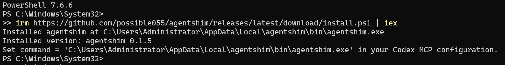

https://linux.do/t/topic/2773290


```bash
irm https://github.com/possible055/agentshim/releases/latest/download/install.ps1 | iex
```




一个星期前版上大佬开源 fastctx
我心里想着，从来没碰过 Rust 的我
能仅靠 AI 从头开发出这样的工具吗?
所以我就做了下去 (又一颗轮子)

## 简介

一共六个工具:

- read：读取档案、PDF (解析为文字或图像)
- grep：正则搜寻 (rg)
- glob：文件匹配
- run_program：不经 shell，直接执行程式命令
- bash：基于 git bash，执行 POSIX 风格 bash 命令
- bash_status：查询背景 Bash 任务状态

### 安裝

**Windows**

```bash
irm https://github.com/possible055/agentshim/releases/latest/download/install.ps1 | iex
```

**Linux / macOS**

```bash
curl -fsSL https://github.com/possible055/agentshim/releases/latest/download/install.sh | sh
```

### MCP 设置模板

```ini
[mcp_servers.agentshim]
required = true
command = "/absolute/path/to/agentshim"
args = ["serve", "--client-profile", "codex"]
# Unrestricted mode (default) allows any absolute read/grep/glob path. To
# restrict to repository and Codex skill/plugin paths, use:
# args = ["serve", "--client-profile", "codex", "--read-scope", "normal"]
supports_parallel_tool_calls = true
tool_timeout_sec = 600
enabled_tools = ["read", "grep", "glob", "run_program", "bash", "bash_status"]
default_tools_approval_mode = "approve"
env = { CODEX_MCP_PROTOCOL_VERSION = "2026-07-28" }

[features]
mcp_2026_07_28 = true
```

## DSH

本服务会覆盖 DSH 原生的 read, grep, glob, bash 和 job_xxx 三个工具

```css
dsh plugin --profile web add dsh-agentshim
dsh web --dump-config
```

## Bug

- 背景 bash 工具没有超时时间
- DSH 必须启用 Full Access 才能使用 bash 工具
- 本插件还没有与 DSH 本体连动沙箱权限设置，所以 grep/glob/read 会被默认限制在项目路径
- 其他尚待发掘

## Github

[github.com](https://github.com/possible055/agentshim)


### [GitHub - possible055/agentshim: High-performance, capability-aware repository...](https://github.com/possible055/agentshim)

High-performance, capability-aware repository tools and process execution for coding agents.

## DSH 插件

https://www.npmjs.com/package/dsh-agentshim

## 词元总消耗

|       Tools | Requests |       Input |    Cache Hits |    Output |
| ----------: | -------: | ----------: | ------------: | --------: |
| Antigravity |    2,929 |  21,885,014 |   263,908,868 | 1,245,360 |
|      Claude |    2,451 |   5,971,820 |   694,577,793 | 2,062,689 |
|       Codex |   12,059 |  57,474,493 | 1,577,557,026 | 4,532,479 |
|       Devin |    5,457 |  23,738,514 |   396,549,567 | 2,004,252 |
|         All |   22,896 | 109,069,841 | 2,932,593,254 | 9,844,780 |
|        All* |   22.90K |        109M |         2.93B |     9.84M |