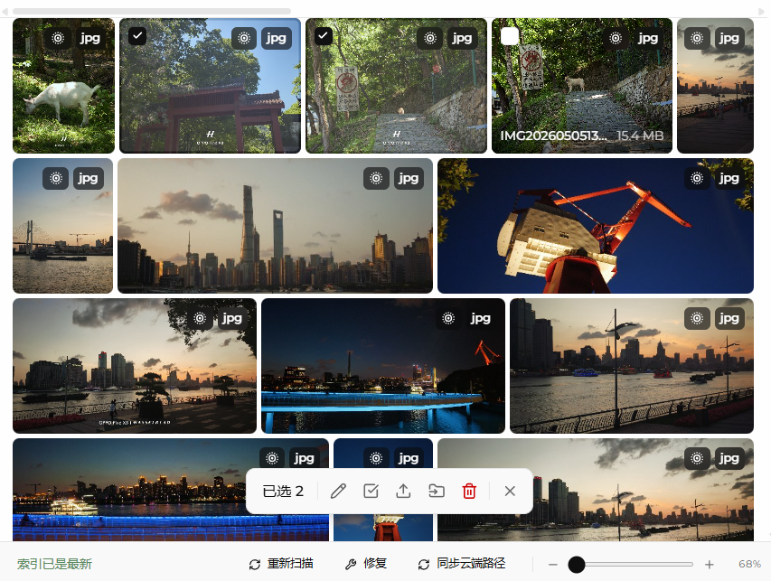

当前浏览视图效果存在大量锯齿、噪点的情况，需优化视觉效果




| 方案                               | 磁盘占用      | 画质         | 实现成本 |
| ---------------------------------- | ------------- | ------------ | -------- |
| CSS `blur(0.5px)`                  | 0             | 能用         | 5 分钟   |
| 帧条 JPG（按需 + 缓存目录）        | ≈ 每张 150 KB | 平滑但帧率低 | 半天     |
| 动态 WebP / 低清 MP4（按需 + LRU） | ≈ 每张 300 KB | 最好         | 一天     |

### 方案一：纯前端 CSS 魔法（成本最低，马上见效）

既然浏览器缩放视频会有锯齿，我们可以用 CSS 人为地给它加一层极弱的“抗锯齿（Anti-aliasing）”滤镜，也就是微小的模糊，配合 GPU 加速。

在你的缩略图 `<video>` 标签加上以下 CSS：

CSS


```
.live-photo-video {
  width: 100%;
  height: 100%;
  object-fit: cover;
  
  /* 1. 强行开启硬件加速，作为一个独立图层渲染 */
  transform: translateZ(0);
  will-change: transform;
  
  /* 2. 核心魔法：加一个极小的模糊，中和掉锐利的锯齿。
     0.4px 到 0.8px 之间效果最好，肉眼看不出模糊，但噪点全没了 */
  filter: blur(0.5px) contrast(1.05); 
  
  /* 3. 告诉浏览器优先考虑图片质量（对部分浏览器 video 标签也有效） */
  image-rendering: high-quality;
}
```

*注：加上 `contrast(1.05)` 是因为轻微模糊会损失一点点对比度，加一点对比度能让画面看起来依然通透。*


### 方案二：转码代理文件（最正规的做法，大厂方案）

不管是苹果 iCloud、Google Photos 还是群晖等 NAS，都不会直接在缩略图里播放原画质视频。
由于你的项目是本地资源库（上一张图看到了 `E:\` 盘），你完全可以在后台用 FFmpeg 偷偷抽帧或转码。

当识别到 Live Photo 时，除了原图，**生成一个专用于悬停播放的“代理视频（Proxy）”**。

**策略 A：生成低分辨率 MP4**
把 1080p 的原视频，压成 480p（甚至 360p）。视频变小后，浏览器就不需要进行剧烈的降采样计算，噪点自然就消失了。

Bash


```
# 后台处理命令示例：将原视频压成高压缩率、低分辨率的 360p 缩略视频
ffmpeg -i input_live.mov -vf scale=-2:360 -c:v libx264 -crf 28 -an thumb_video.mp4
```

**策略 B：生成动态 WebP (强烈推荐)**
浏览器对 `` 标签的缩放算法（默认是高质量的 bicubic）远好于对 `<video>` 标签的缩放算法。
你可以把 Live Photo 的那 3 秒视频，转成一个不停循环的 `animated WebP`，悬停时把原本的静态 `` 的 `src` 替换成这个 WebP。

Bash


```
# 将 3 秒的视频转成 15帧/秒 的动态 WebP
ffmpeg -i input_live.mov -vcodec libwebp -filter:v fps=fps=15 -lossless 0 -compression_level 4 -q:v 70 -loop 0 live_thumb.webp
```

*WebP 的好处不仅是缩放不带锯齿，而且不需要处理 `<video>` 标签的自动播放限制、静音等一堆麻烦的 DOM 状态。*

------

### 方案三：交互层面的“藏拙”（提升 UX）

如果原视频缩得太小就是很难看，我们可以通过交互让它在播放时稍微变大一点，既能减轻降采样压力，又能明确告诉用户“当前正在播放这张”。

**悬停时轻微放大 + 渐现播放**：

1. 默认显示高清 JPG 缩略图。
2. 鼠标悬停时，整个卡片放大 `1.1` 倍（`transform: scale(1.1)`）。
3. 视频在 JPG 上方 **Fade-in（渐显）** 出来开始播放，而不是瞬间硬切。

CSS


```
.tile {
  transition: transform 0.2s cubic-bezier(0.2, 0, 0, 1);
  position: relative;
}

/* 悬停时放大一点点 */
.tile:hover {
  transform: scale(1.05);
  z-index: 10;
  box-shadow: 0 10px 20px rgba(0,0,0,0.2);
}

.tile video {
  position: absolute;
  inset: 0;
  opacity: 0;
  transition: opacity 0.3s ease;
}

/* 悬停时视频渐显 */
.tile:hover video {
  opacity: 1;
}
```

### 总结建议

如果你想今天下午就解决这个问题，立刻加上 **方案一（`filter: blur(0.5px)`）**，你会发现噪点神奇地消失了。
但如果这是一个长期维护的产品，强烈建议采用 **方案二的 WebP 策略**。悬停播放 WebP 的性能开销极低，且因为使用的是 img 渲染引擎，画质异常平滑，这也是目前主流网页版图库（如小红书网页版、Flickr）处理动图预览的标准做法。


----


当前的设计：

**悬停播放 Live Photo 的实现原理**（`desktop/frontend/src/components/media/LivePhotoCanvas.tsx`，资源库卡片悬停时由 `LocalAssetGrid` 挂载）：

1. 每个本地 Live Photo 资产有两份媒体：静图缩略图 + 一段 3 秒左右的短视频（`livePhotoVideoUrl`）。
2. 鼠标悬停卡片时（`onMouseEnter` → `hovering`），组件以 `active=true` 挂载。
3. 一个**隐藏的 `<video>`**（移到屏幕外、1px、透明）加载并静音播放视频。
4. 一个 `requestAnimationFrame` 循环每帧调用 `drawImage(video, …)`，把当前帧画到可见的 `<canvas>` 上，canvas 分辨率固定为**视频原始分辨率**（如 1512×2016）。
5. canvas 本身被 CSS 拉伸铺满约 200px 的瓦片——巨大的位图被浏览器缩小显示。


建议优化方案：

1. **canvas 的位图尺寸 = 显示尺寸 × DPR**（DPR 封顶 2），用 `ResizeObserver` 跟随瓦片大小，缩放滑块改变时也自动适配。
2. `ctx.imageSmoothingQuality = 'high'`。
3. `drawImage` 用 9 参数形式做 **cover 裁切**（canvas 没有 `object-fit`，得自己算）。
4. 缩放比大于 2.5 倍时做**渐进式减半**（ping-pong 两个离屏 canvas），进一步压掉高频，这是 Photoshop / Sharp 缩略图的标准做法。
5. 用 `requestVideoFrameCallback` 代替 rAF，只在视频出新帧时画（30fps 而不是 60fps，开销减半）。