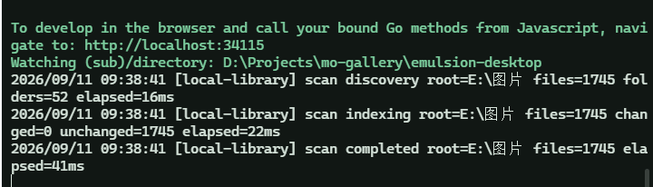

# 本地资源库视频播放：从 WebView 闪退到内置 ffmpeg 与 Range 封顶

> 版本 0.8.3 · 本地资源库新增视频/音频播放、片段标记与导出，随后踩到了 WebView2 的解码深坑。

## 现象

视频网格页停留一会儿后**整个窗口闪退**——大量视频封面加载不出来（只有少数小文件出了图），而终端里的 `wails dev` 进程还活着。打开视频播放也可能触发。



这个特征很关键：`wails dev` 是父进程（构建 + dev server），应用 exe 是它拉起的子进程。**父进程活着、窗口消失 = 应用进程整个死掉了**，而不是前端报错。

## 排查：三个证据

**1. Go 侧没有能杀死进程的路径。** 逐一检查了打开视频触发的所有 Go 链路：视频原文件服务（`http.ServeContent` 流式 + Range，不整读内存）、片段列表、元数据回填、ffmpeg 检测——全是参数化 SQL 和有边界检查的解析，无 panic 点。

**2. 事件查看器 + Crashpad 痕迹指向 WebView2。** 应用程序日志里没有主程序的崩溃记录，但在 `%APPDATA%\Roaming\emulsion-dev.exe\EBWebView\` 下挖到了时间线：

| 时间 | 痕迹 | 含义 |
| --- | --- | --- |
| 09:39:03 | `EdgeWebView` 最后一条 INFO 日志 | WebView2 进程的生命迹象到此为止 |
| 09:39:19 | `Local State` 落盘 | 浏览器进程非正常关闭时写状态 |
| 09:40 | `Crashpad\watson_metadata` 新建 | Crashpad 向 Windows 错误报告移交崩溃 |

主程序没崩、没有崩溃转储、只有子进程被 Crashpad 接管的痕迹——这是 Wails v2 的已知行为：**WebView2 渲染进程崩溃 → 窗口销毁 → 应用静默退出**。

**3. 元凶是一批 DJI 无人机视频。** `E:\图片\DJI\` 下 14 个视频共 8.1GB，从文件尾部探测到 `hvc1` box——**HEVC(H.265) 编码**，4K 长时段录制，单个最大 2.28GB。

## 为什么会崩

视频封面（poster）原本的实现是**前端截帧**：Go 解不了视频帧，所以网格里每张"未出图"的视频卡片挂载时，都会创建一个隐藏 `<video preload="auto">` 加载**原始文件**、seek 到 1/3 处、画到 canvas 导出 JPEG 回传给后端缓存。并发限流 2，但队列会逐个消化所有视频。

于是：一排 2GB 的 4K HEVC 文件排队进 WebView 解码——**Chromium 的硬解路径对这类流崩溃，渲染进程死亡，`onError` 根本来不及触发**。能出图的少数几个是排在前面的小 H.264 文件。"停留一会儿才闪退"正是队列走到重型文件的时刻。

本质上：**把批量视频解码放进了 UI 进程**。

## 专业软件怎么解决

共性不是用什么解码器，而是三条架构原则：**解码永远不在 UI 进程里、优先硬解、缩略图预生成并缓存**。

- **资源管理器 / 照片应用**：Media Foundation（`IMFSourceReader`）+ 系统编解码器，解码跑在 `dllhost.exe` 独立进程，崩了不连累 explorer。注意 MF 解 HEVC 也依赖系统装没装 HEVC 扩展——资源管理器能出图不代表 WebView2 能播，两边是不同的解码路径。
- **剪映 / CapCut**：自带 FFmpeg 系媒体引擎，DXVA/NVDEC 硬解，UI 只拿解码完成的帧，封面导入时后台预生成。
- **Jellyfin / Immich / digiKam**（与图库场景最接近）：清一色 **ffmpeg 子进程**生成封面，子进程天然崩溃隔离。

## 方案选型

| 方案 | 评价 |
| --- | --- |
| **ffmpeg 子进程（Go 侧生成封面）** | 首选：业界标准、任何编码任何体积都稳、进程级崩溃隔离、跨平台 |
| Media Foundation（Windows 底层） | 工程量大（COM 绑定）、仅 Windows、HEVC 仍取决于系统编解码器，性价比低 |
| Windows Shell 缩略图缓存 | 缓存不一定命中，跨平台无从谈起 |
| 继续 WebView 截帧 + 编码门禁 | 只能作为 ffmpeg 缺席时的降级路径 |

新问题：**用户（包括我自己）的机器上根本没装 ffmpeg**。内置进安装包会增大体积，按需下载则要做下载器、多源回退、半安装状态。结论：视频是这个产品的重点功能，"按需"是伪节省，**直接内置**——而且更新器本来就下完整安装包，多 20MB 换开箱即用 + 版本一致性，划算。为避免与系统 ffmpeg 冲突，内置二进制命名为 `emulsion-ffmpeg`。

## 实现

**1. ffmpeg 解析器**（优先级从高到低，进程内缓存一次，每个候选都要过 `-version` 探活）：

```
环境变量 MO_GALLERY_FFMPEG  →  exe 同目录的 emulsion-ffmpeg  →  系统 PATH
```

**2. 封面生成接入 derivative 管线。** 扫描预热本来就会把视频排进缩略图队列（此前被短路成 no-op），所以只需在 `generateDerivative` 的视频分支换成真渲染：

```bash
ffmpeg -ss <min(1s, 时长/3)> -i 源文件 \
  -frames:v 1 -vf scale=... -q:v 4 -f image2 输出
```

`-ss` 放在 `-i` 前是输入寻址（按关键帧跳），**耗时与文件体积无关**；产物走和照片缩略图完全相同的缓存与记账（cache key = id + mtime + size，文件改了自动失效重生成）。信号量限并发 2、单次 45s 超时、临时文件原子改名。

**3. 前端降级护栏。** canvas 截帧降为"无 ffmpeg 时的兜底"：先问后端有没有 ffmpeg（有就完全不截）、加 500MB 体积上限、`preload="metadata"`。播放器 `preload` 也从 `auto` 降为 `metadata`。

**4. 打包内置。** NSIS 模板加一行 `File "..\..\bin\emulsion-ffmpeg.exe"`；macOS 构建后拷进 `.app/Contents/MacOS/` 再签名（universal 用 lipo 合并双架构）；Linux 进 tar/deb/rpm/AppImage 的 `usr/bin`。CI 新增 `ffmpeg-bundle` job：从源码编译 **LGPL 精简构建**——只保留 H.264/HEVC 解码、scale 滤镜、mjpeg 编码和各封装器的流复制（片段导出用 `-c copy`，不需要编码器），裁掉一切无关组件，体积从完整版的 160MB+ 降到十几 MB，也规避了 GPL 分发义务。一个细节：`wails build -clean` 会清空 `build/bin` 把预先放好的 ffmpeg 删掉，CI 里去掉 `-clean`（全新 checkout 本来就无需清理）。

## 验证

对那个曾经稳定复现闪退的 2.28GB HEVC DJI 文件实测：**Go 侧 1.2 秒生成 512×288 封面**，全程不经过 WebView。回归测试中应用不再闪退，DJI 文件夹的封面逐个出图。

## 第二轮：内置 ffmpeg 之后，仍然慢、仍然闪退

封面问题解决后，播放本身又暴露两个症状：**按下播放到真正起播要等好几秒**；播放大文件时**再次闪退**（甚至重启应用后预览模态自动恢复那个视频，形成"重启即闪退"的循环）。

### 排查：一层层排除

1. **Go 服务器洗清嫌疑**。写了个复刻线上行为（`http.ServeContent` + 相同响应头）的独立服务器实测：Range 请求头部/尾部均 **1.5ms** 响应；同一 2.28GB 文件，Chrome 浏览器直连 **308ms 拿到元数据、309ms 可播放**。curl 打真实 dev 链路（wails → vite 404 回落 → Go），206/`Accept-Ranges`/`Content-Length`/`Content-Range` 全部正确——代理链也没有破坏响应头。
2. **给资产处理器加临时请求追踪**（Range 头/状态/字节/耗时逐请求落日志），拿到了决定性的请求序列：

```
bytes=0-          → 206  571,932,089 字节  2.004s   ← 整个 572MB 顺序读光
bytes=571899904-  → 206  32,185 字节       1ms      ← 这才是 moov（在文件末尾）
bytes=1048576-    → 206  570,883,513 字节  503ms    ← 又从头读一遍取播放数据
```

3. **浏览器对照**。同一 URL、同一链路下：Chrome 151 与 WebView2 都以开区间 `bytes=0-` 起手，但 151 会在 demuxer 需要跳转时**掐断连接**、改用尾部 Range 取 moov、655ms 起播；**WebView2（Chromium 152，新媒体缓存栈）从不掐断**，把开区间响应当顺序流喝到 EOF。

### 根因

DJI 等录制设备的 moov 索引写在文件末尾。WebView2 152 的媒体栈对开区间 Range 响应不主动中断，于是整个文件被顺序读完才见到 moov——**几百 MB = 起播等几秒；2.28GB = 渲染进程被灌输撑死**。慢和闪退是同一个 bug 的两种表现。

### 修复：服务端封顶开区间响应

服务器无法改变客户端行为，但可以让"喝"变得无害：`capOpenEndedMediaRange()` 把 `bytes=N-` 改写为 `bytes=N-(N+4MB-1)` 再交给 `ServeContent`。**HTTP 完全合法**——服务器返回的字节可以少于请求的范围。效果：

- 旧式客户端行为不变（本来就在分段请求）；
- 152 式客户端每次最多拿到 4MB，moov 跳转必然变成新的 Range 请求；

实测同一 2.28GB 文件：`bytes=0-` 响应从 **2.04GB 降至 4MB**，尾部 moov 请求 0.22s 返回。对比 faststart 重封装方案（每视频多占一倍磁盘），零成本。

## 小结

- WebView2/Chromium 的解码能力 ≠ 系统能力，HEVC 等"部分视频"会把渲染进程直接打死，且 JS 层无法兜底——**批量解码永远不要放进 UI 进程**；
- 闪退排查时"窗口消失但父进程存活"是子进程/渲染进程崩溃的指纹，事件查看器 + Crashpad 痕迹可以坐实；
- ffmpeg 子进程是图库类应用视频封面的标准答案，内置 LGPL 精简构建让它在体积上也不再是负担；
- **媒体服务器对开区间 Range（`bytes=N-`）必须封顶响应**：你无法预知客户端的媒体栈会不会把整个实体当顺序流读完，moov-at-end 的文件遇上这种行为就是"起播慢 + 大文件崩溃"；
- 排查此类问题的工具组合拳：事件查看器/Crashpad 痕迹 → 独立服务器复刻对照 → 请求序列日志 → 新旧浏览器版本对照。
