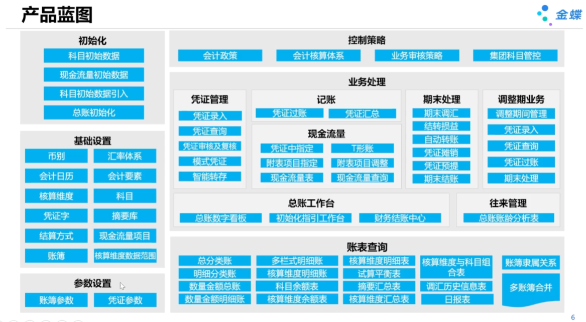
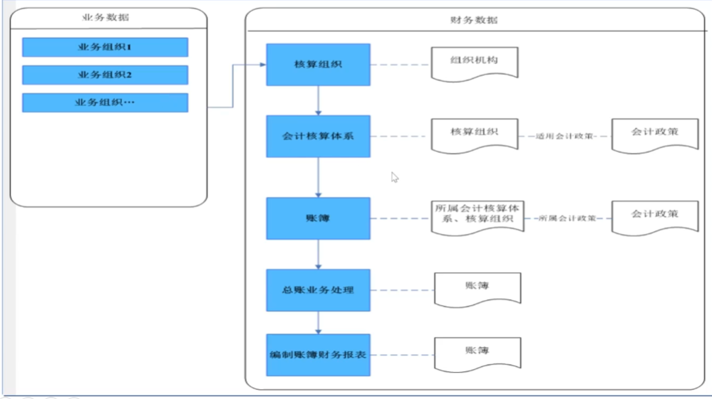
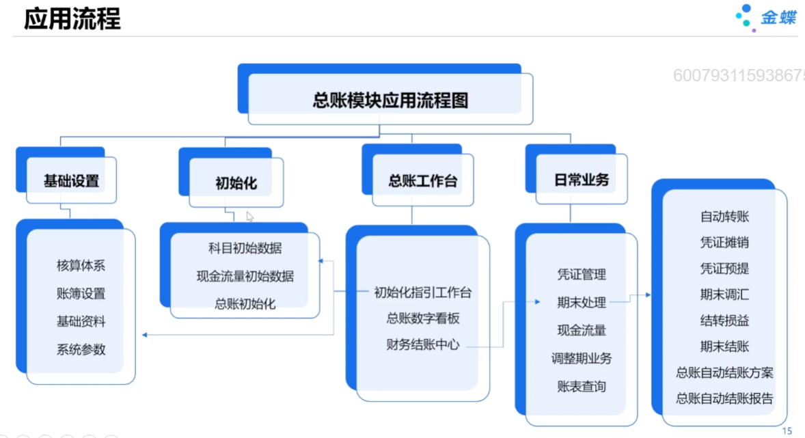
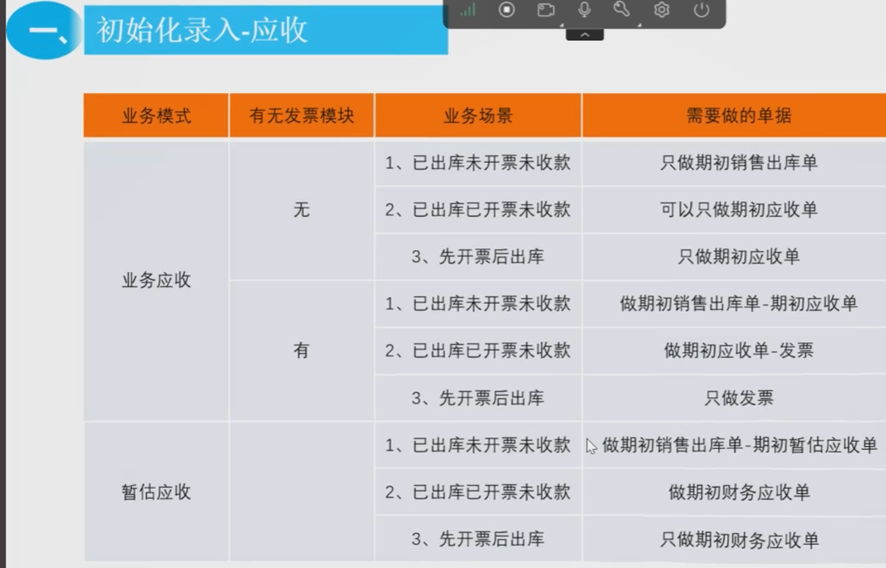

# 总账

## 术语

### 核算组织

- 核算组织即**会计主体**，是会计记账、财务报告的主体。
- 会计主体是对业务范围的划分。法人、利润中心是最常见的会计主体。
- 业务组织记录业务的发生。通过业务组织-核算组织的关系来确定业务的财务归属。从不同的角度，可以将业务组织划分给不同的核算组织。

### 核算体系

- 从不同的视角，账务处理的业务范围划分有所不同。
- 核算体系，即会计核算的范围。
- 在同一核算体系下，业务组织只属于一个核算组织，保证业务记账唯一。
- 业务组织可同时属于多个核算体系下的核算组织。

### 账簿

- 多账簿平行记账，实现按不同会计准则、会计政策、考核体系的记账与财务报告。
- 针对责任中心体系记账，管理凭证记录多维度考核绩效。
- 考核维度可任意扩展，实现多维度的报告与绩效考核。

### 三者之间的关系

## 应用流程

# 应收应付

先开票：前提：启用暂估模式

