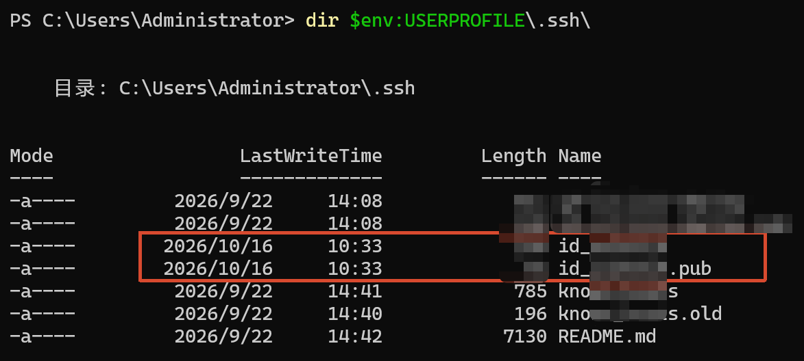
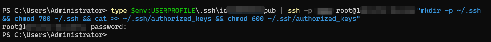

本机Windows

## 生成密钥对

```
ssh-keygen -t ed25519 -C "my-laptop"
```

生成位置：

```
C:\Users\你的用户名\.ssh\id_ed25519       ← 私钥（保密）
C:\Users\你的用户名\.ssh\id_ed25519.pub   ← 公钥（要上传）
```


```
# 1. 看有没有公钥
dir $env:USERPROFILE\.ssh\

# 2. 没有就生成（一路回车，passphrase 留空）
ssh-keygen -t ed25519 -C "my-windows-pc"

```



## 将密钥上传至服务器

### **方法1:PowerShell**

```
type $env:USERPROFILE\.ssh\id_ed25519.pub | ssh -p 22 root@xx.xx.xx.xxx "mkdir -p ~/.ssh && chmod 700 ~/.ssh && cat >> ~/.ssh/authorized_keys && chmod 600 ~/.ssh/authorized_keys"
```



## 方法2:分步骤

第一步：显示公钥内容，复制它

```powershell
type $env:USERPROFILE\.ssh\id_ed25519.pub
```

复制输出的整行（以 `ssh-ed25519` 开头的长串，别漏字符）。

第二步：粘贴到服务器

```powershell
ssh -p 3222 root@107.172.78.135 "echo '粘贴刚才的公钥' >> /root/.ssh/authorized_keys"
```

### 方法 3:手动编辑（最直观，可用记事本）

如果你觉得命令行容易出错，就直接编辑服务器文件：

```powershell
# 用 SSH 登录服务器ssh -p 3222 root@107.172.78.135
```

登录后，在服务器上（这是 Linux 环境）：

```bash
# 用 nano 编辑（没有 nano 就用 vi）nano /root/.ssh/authorized_keys
```

把 Windows 上复制的公钥粘贴到新的一行，保存退出（nano: `Ctrl+O` 回车 `Ctrl+X`）。

再确认权限：

```bash
chmod 700 /root/.sshchmod 600 /root/.ssh/authorized_keys
```