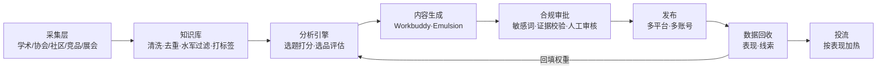
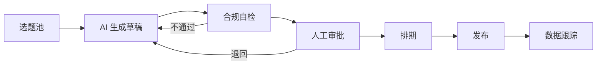

> 全局链路：**信息聚合 → 提炼整合 → 内容生产 → 信息发布 → 数据分析/投流**。第三至七章按这条链路依次展开。

# 一、前提

- 方法论：明确我的行业、我的产品、我的近期目标
- 领域合规性：基于官方提供的标准做内容
- 核心理念：宠物干细胞在大众思维里属于异种新兴治疗方案，需要大量临床实验等权威依据来打消宠物主人的顾虑。

## 1.1 目标与衡量指标

> 平台的每个模块都要能对应到下面某个指标，否则不纳入一期。具体数值待定，下表为填写模板。

| 层级 | 指标 | 目标值（待定） |
| --- | --- | --- |
| 北极星 | 有效线索数（私信咨询、医院合作意向、留资） | |
| 转化 | 咨询率 = 咨询数 / 阅读数；线索成本（投流后） | |
| 内容 | 收藏率、互动率、完读率、涨粉数 | |
| 效率 | 每周产出内容数、单条内容人工耗时、审批通过率 | |
| 选品 | 每月输出的机会清单数、被采纳并验证的方向数 | |

选择原则：收藏率、咨询率比曝光更能反映"信任是否建立"，对医疗属性产品更重要。

# 二、整体实现路径

基于各个独立服务，逐步提炼、整合：

数据采集 → 提炼精选 → 润色 → 通过调用 Workbuddy 实现内容生成 → 人工审批 → 发布 → 数据复盘/投流

## 2.1 系统模块

关键是 G → C 这条回流线：内容表现数据要能反过来修正选题和选品的打分，平台才算"自动化运营"，否则只是自动化发布。

# 三、信息聚合

> 收集国内 / 海外各平台相关数据，聚合有用信息，用于 AI 做内容分析。

| 类别       | 来源         | 用途        |
| -------- | ---------- | --------- |
| 权威信息     | 机构与协会、学术平台 | 内容的专业依据   |
| C 端信息    | 社区平台       | 用户痛点、热点话题 |
| 行业动态     | 竞争公司、展会    | 同行与市场动向   |
| ~~电商信息~~ | 电商平台       | 暂不纳入      |

**采集策略**：

1. **关键词库**：按三层维护，所有来源共用。
	- 产品层：干细胞、间充质干细胞（MSC）、细胞治疗、再生医学、外泌体
	- 病种层：猫传腹（FIP）、慢性肾病（CKD）、髋关节发育不良、骨关节炎、脊髓损伤、炎症性肠病等
	- 用户表达层：口语化说法和错别字，如"猫传腹还有救吗""肾衰晚期""瘫了能好吗"，从社区帖子中持续补充
2. **采集频率**：社区平台每日；竞品公众号/官网每周；学术平台、专利库每周增量；协会、展会按月或按会期。
3. **统一字段**：来源、链接、发布时间、作者/机构、正文摘要、互动数据（点赞/评论/收藏/引用）、病种标签、采集时间。字段统一后才能进入知识库做去重和打分。
4. **可信度分层**：学术/协会 > 竞品官方 > 社区内容。社区内容只作为"需求信号"，不作为内容论据。

## 3.1 机构与协会

- 国内：
	1. 中国兽医协会（宠物诊疗分会）
	2. 中国畜牧兽医学会小动物医学分会
	3. 东西部小动物临床兽医师大会（WESAVC）
	4. 北京/上海行业协会
	5. 宠医客等。
- 国际：
	1. WSAVA（世界小动物兽医师协会）
	2. AAHA（美国动物医院协会）
	3. AVMA（美国兽医协会）

## 3.2 学术平台

> 通过关键词检索相关学术文章，采集论文信息及浏览量、引用量、检索量等数据。

1. PubMed
2. ScienceDirect
3. CNKI 知网
4. Google Scholar

## 3.3 社区平台

> 针对领域搜索相关板块，采集论坛及相关平台数据。

- 国内：
	1. 公众号
	2. 微博
	3. 豆瓣
	4. **贴吧：猫传腹吧、猫慢性肾衰吧、犬髋关节发育不良（CHD）吧、骨科/神经疾病讨论区**
	5. **微信社群：老年宠护理群、瘫痪犬猫轮椅康复群**
- 海外：
	1. Reddit
	2. X

## 3.4 竞争公司

> 收集同类公司同类产品最新资讯，信息提炼。来源：公众号、官网等。

1. 专利与科研立项公开库（企查查/专利局监控同行研发动态）
2. 企业融资动态
3. 招聘信息

## 3.5 展会

> 关注展会信息、同行、行业动态。

- 国内：
	1. 亚洲宠物展（亚宠展）
- 国外：
	1. Global Pet Expo（北美奥兰多全球宠物展）
	2. Interzoo（德国纽伦堡展，全球最大）
	3. VET Show（伦敦/纽约国际兽医年会）
	4. SuperZoo（拉斯维加斯）

## 3.6 电商平台（暂不纳入）

- 淘宝
- 抖音/TikTok
- 亚马逊

> 说明：电商评论、销量、价格带是选品的直接信号（见 4.3），一期暂不采集，计划在二期接入（见第八章）。一期可用人工抽样代替。

# 四、提炼整合

> 类似于 RAG：基于第三章各来源数据，提炼值得注意的内容、选品、加大宣传的方向，并注明信息来源依据。

## 4.1 核心功能

- **水军识别**：识别社交平台主题（帖子/视频）及其评论、子评论内容的疑似水军概率。
- **热点抓取**：基于实时、高点赞、高浏览的信息做回复量分析，并结合水军识别过滤。

**水军识别信号**（规则初筛 + AI 判断，输出疑似概率）：

| 层面 | 信号 |
| --- | --- |
| 账号 | 注册时间短、头像/昵称模板化、历史内容集中在单一产品、粉丝少但发帖频繁 |
| 内容 | 评论文本高度相似、品牌名/产品名密集出现、缺少具体细节（病程、用药、时间） |
| 行为 | 短时间内集中出现、点赞与评论比例异常、多账号互相回复 |

概率高于阈值的内容不计入热度和共鸣度；竞品集中出现的水军也可作为竞品投放动向的信号。

## 4.2 选题方法（初版，待数据验证）

> 回答"如何提炼到有用的内容，提高内容成为流量爆款的概率？"。以下为初始方法，权重需用第七章的数据持续校准。

**选题公式**：选题 = 真实痛点 × 权威证据 × 合适人设

1. **挖痛点**：从社区平台抓取高互动帖（过滤水军后），用 AI 抽取用户的原始问题，按病种和问题类型聚类（如"猫传腹还有没有办法""肾衰能活多久""手术后瘫痪能恢复吗"）。
2. **配证据**：每个问题簇到知识库匹配文献/临床依据，按证据等级标注（见 4.3）。没有证据支撑的问题只做情感陪伴类内容，不做疗效类内容。
3. **定人设**：
	- 疗效/机制类 → 专家/研发人设
	- 诊疗方案/病例类 → 临床医生人设
	- 康复过程/情感类 → 宠主故事人设
4. **做测试**：同一选题生成 3～5 个标题/封面版本，小流量发布或在矩阵账号间 A/B，表现好的再放量、投流。

**选题打分（用于排序）**：

$$
\text{选题分} = w_1 \cdot \text{热度} + w_2 \cdot \text{共鸣度} + w_3 \cdot \text{证据强度} + w_4 \cdot \text{竞争空白}
$$

- 热度：讨论量及近 30 天增速
- 共鸣度：收藏/评论比、评论中"求助""同款"类表达占比
- 证据强度：可引用文献的数量和等级
- 竞争空白：同平台同题材头部内容数量（越少越高）
- 初始权重可设为均等，跑满一个月后按实际表现回归调整

**内容配比（建议初值）**：科普/机制 40%、病例/康复故事 40%、产品相关 20%。产品内容占比过高会削弱矩阵账号的信任感。

## 4.3 选品机会评估

> 目标：每周/每月输出一份"选品与宣传方向机会清单"，每条附信息来源。

**评估维度**：

| 维度 | 信号来源 | 说明 |
| --- | --- | --- |
| 合规可行性 | 法务/官方标准 | **一票否决**：不能合法宣传的方向直接剔除 |
| 需求强度 | 社区平台、（二期）电商评论 | 病种讨论量、求助帖数量、增长趋势 |
| 证据强度 | 学术平台、协会 | 见下方证据分级 |
| 竞争格局 | 竞争公司、展会、专利 | 竞品是否已布局、宣传力度 |
| 商业价值 | 内部数据、医院合作方 | 客单价、复购/疗程、医院渠道可达性 |

**证据分级**（决定内容能说到什么程度）：

1. A 级：系统综述、随机对照试验 → 可作为核心论据
2. B 级：队列研究、多中心病例系列 → 可引用，需注明样本量
3. C 级：个案报道、体外/实验动物研究 → 只能表述为"研究探索中"
4. D 级：无文献，仅经验或用户反馈 → 不作疗效表述

**产出格式**（每条机会）：方向名称、目标病种、各维度评分、关键证据链接、竞品情况、建议动作（加大宣传/观察/放弃）。

# 五、内容生产

## 5.1 内容类型

- **软文/科普**：用于知乎、小红书推广。对接企业知识库整理，移除关键敏感内容，生成大众可接受的语义和内容，适当做专业名词科普。发布主体：矩阵账号、官方账号。
- **产品推广**：由主体账号发布。

## 5.2 内容形式（AI）

- 图文文章
- 视频/数字人

## 5.3 素材管理

- 可基于 Emulsion
- AI 生图、改图、AI 视频

## 5.4 合规审核机制

> "基于官方标准做内容"需要落到流程里。产品的注册类别（兽药/兽用生物制品/医疗服务等）及对应的广告审查要求需法务确认，以下为流程框架。

1. **禁用表述库**：维护敏感词与禁用说法清单（如"治愈""根治""100%有效""无副作用"、与竞品贬低性对比等），生成阶段即过滤。
2. **宣称必须带证据**：凡涉及疗效、机制的句子，必须挂上知识库中的来源，并符合 4.3 的证据分级；无来源的宣称自动标红退回。
3. **分级审批**：
	- 科普/故事类：AI 自检 + 运营人工审核
	- 疗效/产品类：AI 自检 + 运营审核 + 专业人员（兽医/研发）审核
	- 广告投放素材：额外经法务确认
4. **病例与隐私**：宠主案例需取得授权，医院病例需脱敏。
5. **留痕**：每条内容保存生成版本、修改记录、审批人和引用来源，便于追溯。
6. **AI 生成标识**：按各平台规则标注 AI 生成内容。

# 六、信息发布

> 聚焦国内外自媒体发布：基于聚合内容自动发布吸引读者的内容。需对接各发布平台的发布接口。

## 6.1 账号体系

> 多平台账户管理，不同账号属性发布不同内容。

- **矩阵账号**：发布科普/权威实事，以公众号/小红书为主，并做海外宣传，扩散影响力。账号人设：
	- 专家/研发人设
	- 临床医生/合作医院视角
	- 宠主故事/救助视角（成功案例）
- **主体账号**：产品推广

**人设运营方法**：

| 人设 | 内容重点 | 建议频率（初值） | 信任来源 |
| --- | --- | --- | --- |
| 专家/研发 | 文献解读、机制科普、行业进展、展会见闻 | 每周 1～2 条 | 学历/机构背景、引用文献 |
| 临床医生 | 病种科普、诊疗方案对比、病例观察、答疑 | 每周 2～3 条 | 执业资质、合作医院 |
| 宠主故事 | 康复全过程、日常护理、情绪陪伴 | 每周 2～3 条 | 连续记录、真实细节 |
| 主体账号 | 产品信息、品牌动态、合作医院 | 每周 1～2 条 | 官方资质 |

原则：

- 人设必须有真实人员或授权案例对应，不虚构医生和宠主身份。
- 矩阵账号之间不直接互推产品，通过话题和评论区自然关联到主体账号。
- 同一选题可在不同人设间做不同角度的改写，提高素材复用率。

## 6.2 发布平台

- 国内（以公众号、小红书为主要运营平台）：
	- 公众号/视频号
	- 小红书
	- 抖音
- 海外：
	- X（目前可实现自动化发布）
	- Reddit
	- TikTok

**自动化可行性**（决定一期的发布方式，具体以各平台当前规则为准）：

| 平台       | 方式  | 说明                              |
| -------- | --- | ------------------------------- |
| X        | 全自动 | 已有官方 API                        |
| 公众号      | 半自动 | 生成草稿 → 人工确认发布                   |
| 小红书 / 抖音 | 半自动 | 无开放的个人发布接口，模拟操作有封号风险；生成内容包，人工发布 |
| Reddit   | 半自动 | 社区对营销内容敏感，需人工把控                 |

## 6.3 发布流程

**AI 托管** + 流程审批（人工介入）

内容状态流转：

- **排期**：按平台维护内容日历，初期参考各平台常见活跃时段，之后用 7.1 的数据更新。
- **评论区运营**：发布后 24h 内由 AI 起草回复、人工确认；涉及病情咨询的私信统一引导至专业人员，不由 AI 直接给出诊疗建议。

## 6.4 外部合作

- 宠物细胞部分产品属于医疗类目，可联合相关医院做进一步推广和内容发布；
- 与同领域自媒体账号合作发布。

**医院合作模式**：

1. 联合病例：医院提供脱敏病例与随访数据，双方共同署名发布。
2. 医生专栏：合作医生以个人身份在矩阵账号或自有账号输出科普。
3. 线下转化：内容中的咨询线索按地域分配给合作医院，线索去向用于评估合作效果。

**KOL/KOC 筛选**：

- 粉丝画像与目标病种匹配（看评论区是否有真实病宠主人，而不是只看粉丝数）
- 过往内容无夸大疗效、无违规记录
- 用 4.1 的水军识别方法检查其评论区数据真实性
- 优先腰部和垂直病种博主，按单条效果（收藏、咨询）结算或复投

# 七、数据分析与投流

## 7.1 数据分析

复盘、方案改进。

- 维度：内容审计、发布时间
- 其他数据分析平台（待补充）

**数据回流方法**：

1. **内容打标签**：每条内容发布时记录病种、人设、形式（图文/视频）、标题钩子类型（提问/数字/故事/反常识）、证据等级、发布时间、账号。
2. **统一采集指标**：按 1.1 的指标体系，发布后 24h / 72h / 7d 各采集一次。
3. **按标签归因**：每周对比各标签组合的收藏率、咨询率，找出表现好的组合。
4. **回填权重**：
	- 表现好的病种 → 提高选题打分中的热度/共鸣权重，并作为选品清单的需求信号
	- 表现好的人设/形式 → 调整内容配比
	- 表现好的发布时间 → 更新各平台排期
5. **复盘节奏**：周报看内容表现，月报看选品方向和指标达成。

## 7.2 内容投流

> 根据内容发布后的数据自动投流。

平台：
- 小红书：聚光/薯条
- 微信：朋友圈/公众号（广告）/微信小程序
- 抖音：千川/巨量投流
- 海外：Meta Ads/Google Ads

需考虑：预算控制、交易层面、各投流平台对接

**投流规则（建议）**：只给已验证的内容加热。例如自然流量下收藏率、咨询率进入账号前 20% 的内容，才进入投流池；设定单条和每日预算上限，线索成本超过阈值自动停投。

# 八、分期规划

| 阶段 | 时间（待定） | 范围 | 验收标准 |
| --- | --- | --- | --- |
| 一期 MVP | 第 1～2 月 | 采集学术平台 + 2～3 个病种贴吧 + 竞品公众号；知识库与选题打分；AI 生成图文 + 合规审批；X 自动发布，公众号/小红书半自动；内容打标签和数据记录 | 每周稳定输出选题清单和内容；数据能回填 |
| 二期 | 第 3～4 月 | 增加视频/数字人；扩展社区和协会来源；接入投流（小红书、微信）；输出首份选品机会清单 | 线索成本可计算；选品清单被业务采纳 |
| 三期 | 第 5 月起 | 接入电商数据；选品评估模型化；自动投流与预算控制；海外 Meta/Google Ads | 选品方向经市场验证；投流 ROI 达标 |

# 九、风险与待确认

| 风险 | 影响 | 应对 |
| --- | --- | --- |
| 产品注册类别与广告审查要求不明确 | 内容和投流可能违规 | 一期前由法务确认，形成书面标准 |
| 微信社群、贴吧采集涉及平台规则与个人信息 | 法律与封禁风险 | 只采集公开内容，去除个人身份信息；社群以人工整理为主 |
| 国内平台无开放发布接口 | 自动发布不可行或封号 | 采用半自动发布（见 6.2） |
| AI 生成内容出现事实错误 | 损害专业信任 | 证据挂载 + 专业人员审核 |
| 矩阵账号被判定为营销号 | 限流 | 控制产品内容比例，人设内容需真实可追溯 |

# 附录：相似需求

